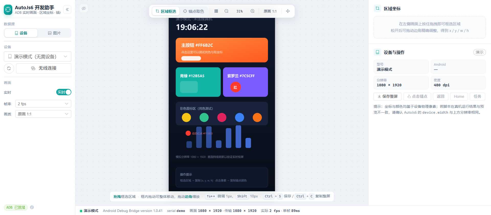
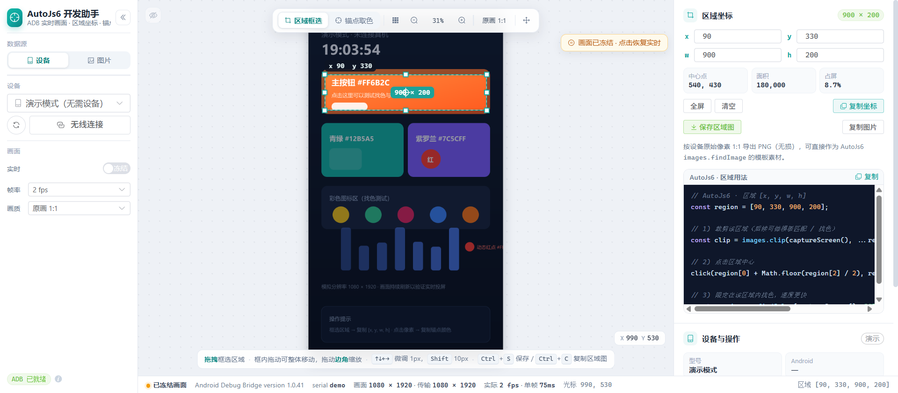
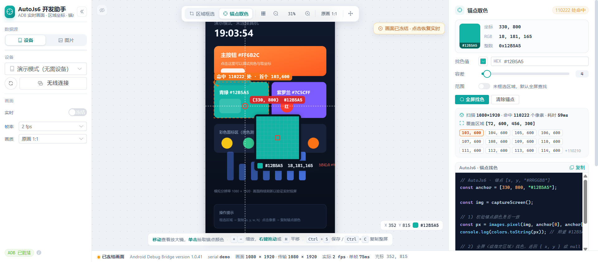
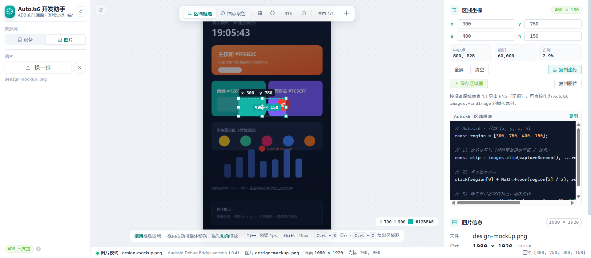

# AutoJs6 开发助手

面向 [AutoJs6](https://github.com/SuperMonster003/AutoJs6) 脚本开发的辅助工具：在浏览器里直接看到手机画面，
拖一下就拿到区域的 `x / y / w / h`，点一下就拿到锚点坐标与精确颜色，并直接生成可粘贴的 AutoJs6 代码。

技术栈：**Vite + Vue 3 + Element Plus**，后端逻辑以 Vite 插件形式内置（`server/`），通过 **ADB** 与 Android 设备通信。

## 功能

- **设备连接**：自动列出 `adb devices` 中的设备，支持 USB 与无线（`adb connect ip:port`）。
- **两种数据源**：可以取真机实时画面，也可以**上传本地图片**（或直接把图片拖到画面里）做区域坐标与锚点取色；
  图片会被归一化成 PNG 交给同一套取色 / 找色 / 裁剪管线，所以坐标与颜色跟真机完全一致，与设备无关时也能用。
- **实时投屏**：服务端 `adb exec-out screencap -p` 抓帧 → sharp 缩放后以 **PNG 无损**推流 → WebSocket 推送，支持刷新率与清晰度调节，
  **清晰度可选「原画 1:1」**，按设备真实像素推送（3200×1440 每帧约 2.6MB）。
- **区域框选**：在画面上拖拽得到 `[x, y, w, h]`（设备物理像素），支持整体拖动、8 个控制点缩放、方向键微调（Shift ×10）。
- **画布缩放 / 平移**：浮动工具栏提供 **原画 1:1** 一键预设（原画会同时把传输切到 1:1），
  点百分比数字或按 `0` 可回到适应屏幕；也可 `+` `-`、Ctrl+滚轮微调（最大 16×）；
  放大后**按住鼠标右键拖动**即可平移，或按 `H` / 点 ✥ 切到移动模式。
- **宽屏自动侧栏**：浏览器宽大于高时，顶栏自动变成左侧竖栏（设备、画面设置竖排），
  点标题右侧的 `«` 可收起成图标条，`»` 展开，收起状态会记在本地。
- **悬浮工具栏可隐藏**：点画面左上角眼睛按钮（或按 `T`）隐藏上下两条悬浮工具栏与坐标读数，得到干净的画面视图，再点一次恢复。
- **右侧面板跟随模式**：选「区域框选」时右侧只显示区域坐标，切到「锚点取色」时只显示取色/找色面板，设备操作区常驻。
- **区域截图导出**：把框选区域按 1:1 原始像素导出为 **PNG（无损）**，或直接复制到剪贴板，可直接作为 `images.findImage` 的模板素材；也可保存整屏截图。
- **中心点偏移**：框好区域后点「添加偏移点」（或画面工具栏的取点按钮 / `P`），在画面上点任意位置，
  立即得到它**相对区域中心**的偏移量 `Δx / Δy` 与绝对坐标；可连点多个，画面上有虚线连线与序号标注，
  列表里逐个删除，一键复制偏移数组。偏移是**相对量**，区域整体平移 / 缩放后依旧成立，
  特别适合「先 `findImage` 找到模板，再点模板中心附近某个固定相对位置」的脚本。
- **一键保存 / 复制（Ctrl / ⌘ + S、Ctrl / ⌘ + C）**：有框选就取区域，没有就取整屏；取的是屏幕上正在看的那一帧（带 frameId），冻结画面时不会跑偏。
  复制走异步剪贴板（`ClipboardItem` 直接吃 Promise），剪贴板不可用时自动退化为保存文件。
- **锚点取色**：单击像素读取**精确颜色**（基于原始 PNG，非压缩后的画面），放大镜实时预览、颜色可编辑、容差可调。
- **全屏找色**：按 AutoJs6 `images.findColor` 的语义（逐通道容差）在原始截图中扫描，返回命中数量、覆盖区域与前若干个坐标。
- **代码生成**：区域 / 锚点 / 找色 三段 AutoJs6 代码一键复制；区域那段依次给出**裁剪、点击中心、区域内找色、
  区域内找图（单处，`images.findImage`）、区域内找图（多处，`images.matchTemplate` 一次返回所有命中点）**示例，
  模板直接用上面导出的区域 PNG。
- **设备操作**：保存整屏、按锚点点击、返回 / Home / 最近任务。
- **演示模式**：没有设备时自动生成一块会动的模拟屏幕，功能可完整体验。

## 界面预览

> 截图取自「演示模式」（未连接设备时会自动生成一块模拟屏幕），宽屏下顶栏自动变成左侧竖栏。

**主界面**：左侧数据源与画面参数，中间实时画面，右侧区域坐标 / 锚点取色与设备操作。



**区域框选**：拖一下就得到 `x / y / w / h`，右侧同步给出中心点、面积、占屏比与可直接复制的 AutoJs6 代码。



**锚点取色**：单击像素读到精确颜色（取自原始 PNG），并顺手按该颜色全屏找色、在画面上标注命中范围。



**图片数据源**：把本地截图 / 设计稿拖进画面就能分析，坐标、取色、找色、导出与真机模式完全一致
（此时「画面」实时参数组会自动隐藏）。



## 快捷键

> 侧栏最下方的 **设置 → 帮助 · 快捷键** 里也列出了完整的按键表。

| 按键 | 作用 |
| --- | --- |
| `Ctrl` / `⌘` + `S` | 保存图片：**有框选存区域图，无框选存整屏**（图片模式同理；未载入图片时不响应） |
| `Ctrl` / `⌘` + `C` | 复制图片到剪贴板：有框选复制区域，无框选复制整屏；在输入框内或已选中文字时仍是普通复制 |
| `1` / `2` | 切换「区域框选 / 锚点取色」模式（右侧面板随之切换） |
| `T` | 显示 / 隐藏画面上的悬浮工具栏（也可点画面左上角的眼睛按钮） |
| `+` `-` | 放大 / 缩小画布（Ctrl + 滚轮同样可缩放） |
| `F` / `0` | 适应屏幕（重置缩放与平移） |
| `O` | 原画 1:1（一个设备像素对屏幕一个像素，并切到原画传输） |
| `C` | **区域框选**：复制光标当前坐标（悬停即可）——未框选为 `[x, y, 0, 0]`，框选后带上真实 `w / h`；**锚点取色**：复制当前颜色 |
| `Shift` | 切换上面按 `C` 复制的格式：区域框选在 `[x, y, w, h]` / `x, y, w, h`（去掉方括号）/ 自定义模板之间循环；锚点取色为 `#ffffff` / `rgb(255, 255, 255)` / `0xffffff` |

> 自定义模板在 **设置 → 通用 → 坐标格式 = 自定义模板** 里填写，默认留空、需要自己写；支持 `${region}`（`[x, y, w, h]`）、
> `${x}`、`${y}`、`${w}`、`${h}` 五个占位符，只做字符串替换、不会执行你的代码。
| `H` | 切换「移动画面」模式 |
| 鼠标右键拖动 | 临时平移（无需切换模式） |
| `G` | 显示 / 隐藏坐标网格 |
| `P` | 开启 / 结束「中心点偏移」取点（需先框选区域，焦点在画面上） |
| `↑` `↓` `←` `→` | 微调区域 1px（Shift 为 10px） |
| `Esc` / `Delete` | 清除区域（取点中 `Esc` 只退出取点） |
| `R` | 恢复实时画面 |

## 环境要求

- Node.js ≥ 18
- Android Platform Tools（`adb` 在 PATH 中，或用 `ADB_PATH` 指定绝对路径）
- 设备已开启「USB 调试」并在手机上点击「允许 USB 调试」

## 启动

```bash
npm install
npm run dev          # 打开 http://127.0.0.1:5174
```

> 该工具依赖 Vite 开发服务器提供的 `/api/*` 与 `/ws/screen`，请使用 `npm run dev`（`npm run build` 仅生成静态资源，不含设备通信后端）。

指定 adb 路径：

```bash
# Windows
set ADB_PATH=D:\platform-tools\adb.exe && npm run dev
# macOS / Linux
ADB_PATH=/Users/me/platform-tools/adb npm run dev
```

## 使用流程

1. 顶部选中设备，画面开始刷新（侧栏「实时 / 冻结」开关可手动冻结；在画面上操作会自动冻结，避免目标移动，
   此时状态栏会显示「恢复实时」按钮；设备掉线时同样自动冻结并保留最后一帧，按钮变成「重连设备」）。
   需要看清细节时点浮动工具栏的 **原画 1:1**（会自动切到 1:1 传输并放大到 100%）。
2. 「区域框选」模式：拖拽框选 → 右侧读取 `x / y / w / h`、中心点、面积、占屏比 → 复制坐标或代码。
   点「保存区域图」按原始像素导出 PNG，或「复制图片」直接粘到聊天工具 / 设计软件里。
3. 「中心点偏移」：框好区域后点右侧「添加偏移点」（或按 `P`），再在画面上点目标位置，
   就能读出它相对区域中心的 `Δx / Δy` 与绝对坐标；可连点多个、逐个删除、复制偏移数组，
   生成的代码会带上 `center + offsets` 的点击示例（适合「找图之后点模板附近固定位置」）。
4. 「锚点取色」模式：单击目标像素 → 得到 `[x, y, "#RRGGBB"]`，自动按该颜色全屏找色并标注命中点。
5. 需要限定范围找色时，先框选区域，再在锚点面板打开「范围」开关。
6. 放大后按 **鼠标右键拖动**（或按 `H` 开启移动模式）平移画面，`0` / 点百分比回到适应屏幕。
7. 想看清全貌又不被 UI 干扰，按 `T` 隐藏悬浮工具栏；`1` / `2` 可在两种模式间来回切。
8. 宽屏下顶栏在左侧，点 `«` 收起侧栏可换来更宽的画面区（窄屏自动变回顶部横栏）。
9. 只想分析一张截图/设计稿：左侧「数据源」切到 **图片** → 选择图片（或直接把图片拖到画面），
   之后框选、取色、找色、保存区域图与真机模式完全一致（此时「画面」实时参数组会自动隐藏，因为没有推流可调）；
   点「回到设备」随时切回实时画面。

## 关于精度与性能

- 坐标与颜色均取自设备**原始分辨率**的 PNG，与 AutoJs6 中 `device.width / device.height`、`images.pixel()` 的坐标系一致。
- **全链路 PNG 无损**：投屏帧、区域导出、整屏截图、剪贴板图片都是 PNG，没有任何有损压缩环节。
  `scale > 1` 时用 nearest 邻近采样缩放（不是插值），预览里不会出现设备上不存在的颜色，但若干相邻像素会合并成一个色块；
  需要逐像素精确取色时请用 **原画 1:1**，此时帧字节与设备截图完全一致（见下条）。
- **原画 1:1 直接透传**：`scale = 1` 时服务端不重编码，直接把 `screencap` 的原始 PNG 字节推给前端（0ms、字节级一致，实测比 sharp 重编码体积还小）。
- PNG 帧比 JPEG 大（1.5K 屏原画约 3MB/帧），走本机回环传输没有压力；`compressionLevel` 只影响缩放帧的体积与编码耗时，不影响任何像素值。
- 画面刷新率取决于设备 `screencap` 速度（Windows 下 1080p 通常 0.7–1.5 fps，2K/1.5K 屏可能 0.3–0.5 fps）。
  逐个像素级的精确取色必须依赖完整截图，因此这里优先保证「值正确」而非「画面流畅」。状态栏会显示真实帧率与单帧耗时。
- 服务端保留最近 6 帧原始截图（环形缓冲）：前端请求携带 `frameId`，取色/找色直接命中**你正在看的那一帧**，
  既避免重复截屏，也避免「画面与取到的颜色不一致」。

## 接口一览

| 方法 | 路径 | 说明 |
| --- | --- | --- |
| GET | `/api/env` | adb 版本与状态 |
| GET | `/api/devices` | 设备列表（含分辨率） |
| POST | `/api/connect` | 无线连接 `{ address }` |
| GET | `/api/info?serial=` | 分辨率 / 密度 / 型号 / Android 版本 |
| GET | `/api/snapshot?serial=&scale=` | 单张 PNG 截图（无损） |
| POST | `/api/shot` | 1:1 原始像素截图 `{ serial, frameId, region?, fresh? }`，返回 PNG（无损） |
| POST | `/api/pick` | 精确取色 `{ serial, x, y, frameId }` |
| POST | `/api/image` | 上传图片作为数据源 `{ name, dataUrl }` → 返回 `serial: "file:xxx"`，之后各接口照常用 |
| GET | `/api/pixel?serial=&x=&y=&frame=` | 精确取色（GET 形式） |
| POST | `/api/findColor` | 全屏找色 `{ serial, color, threshold, region, frameId }` |
| POST | `/api/tap` `/api/swipe` `/api/key` | 设备操作 |
| WS | `/ws/screen?serial=&fps=&scale=&level=` | 投屏推流（PNG 无损，`level` 仅影响体积） |

## 已知限制

- 仅支持 Windows / macOS / Linux 桌面端运行（依赖本机 adb），手机浏览器无法使用。
- 无线调试需设备与电脑同一局域网，并先 `adb tcpip 5555`。
- 未实现模板匹配、多点找色；如需可在此基础上扩展 `/api/findColor` 的同族算法。
